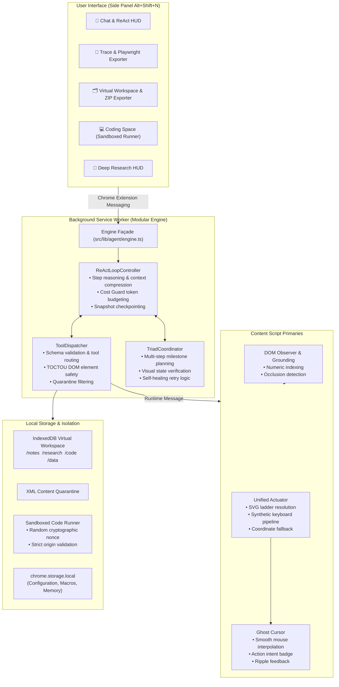

# NIM AGENT — Autonomous AI Browser Assistant

[](https://github.com/mohammedila812-NIM/NIM_AGENT/actions/workflows/ci.yml)
[](https://github.com/mohammedila812-NIM/NIM_AGENT/releases)
[](https://developer.chrome.com/docs/extensions/mv3/intro/)
[](https://vitest.dev)
[](https://playwright.dev)
[](https://www.typescriptlang.org)
[](LICENSE)
[](LICENSE)

> **The zero-backend, multi-model autonomous AI browser agent extension for Chrome, Edge, and Brave.**  
> Powered by **NVIDIA NIM, Google Gemini, OpenAI, Groq, and local Ollama**.  
> Features **Prompt-to-Playwright Test Generation**, **Whisper Voice Dictation**, **Reels/Shorts Autopilot**, **Two-Stage Mind2Act Grounding**, an **IndexedDB Virtual Workspace**, and **Ambient In-Page Telemetry**.

---

## ⚡ What Makes NIM Agent Different?

Unlike Python-heavy frameworks or cloud-hosted agent services that require external daemon processes, CDP proxies, or expensive cloud subscriptions, **NIM Agent runs 100% inside your real browser as a Manifest V3 extension**:

- 🔧 **Security-First DevTools (CDP) Control:** Direct Chrome DevTools Protocol integration through a single strict chokepoint with Capability Tiers (T0 read-only, T1 storage reads, T2 live runtime writes, T3 evaluation), TOCTOU payload-hash binding, automated undo snapshots, and Human-In-The-Loop diff approvals.
- 🤖 **Specialist Sub-Agent Delegation:** The main agent can delegate heavy coding, debugging, or deep analysis to dedicated sub-agent models (DeepSeek R1, Claude 3.5 Sonnet, Llama 3.3 70B) with tab mutating locks while the primary agent continues orchestrating.
- 🎭 **Prompt-to-Playwright Code Generator:** Turn any natural language browsing interaction into production-ready Playwright test scripts (TypeScript & Python) with 1 click.
- 📦 **In-Browser Virtual Workspace (VFS):** Built-in IndexedDB file system (`/notes`, `/research`, `/code`, `/data`). Export anytime as a clean **ZIP archive**, a **GitHub Gist**, or a consolidated **Markdown Dossier** — zero external dependencies.
- 🎬 **Ghost Cursor & Real-Time DOM Telemetry:** Watch the agent's intent unfold with smooth synthetic mouse interpolation, floating intent badges, and visual click ripple effects.
- 🛡️ **Military-Grade Security & Isolation:** Cryptographic nonce-isolated JavaScript sandbox, selective `<untrusted_external_content>` XML quarantine demarcation against indirect prompt injections, and fail-closed domain blocklists.
- 🚀 **Universal LLM Inference:** Switch effortlessly between **DeepSeek**, **NVIDIA NIM**, **Google Gemini**, **OpenAI**, **Groq**, or completely offline **local Ollama** (`http://localhost:11434`).

---

## 📊 Competitive Matrix: How NIM Agent Compares

| Feature / Capability | **NIM Agent** (v1.4.2) | **Browser-Use** | **Stagehand** | **MultiOn** |
| :--- | :---: | :---: | :---: | :---: |
| **Runtime Architecture** | **In-Browser MV3 Extension** (Zero Backend) | Python CLI / Local Daemon | Node.js / Playwright SDK | Cloud Service / SaaS API |
| **Installation Friction** | **1-Click Unpack / Load Extension** | Requires Python, Poetry, Chromium | Requires Node.js script setup | API Key + Cloud Account |
| **Direct Session Reuse** | ✅ **Uses your existing cookies & logins** | ❌ Spawns blank browser profile | ❌ Spawns blank browser context | ❌ Remote cloud proxy |
| **Prompt-to-Playwright Export** | ✅ **Built-in (1-Click TS & Python)** | ❌ No | ❌ No | ❌ No |
| **In-Browser Virtual File System** | ✅ **IndexedDB VFS (`/notes`, `/code`...)** | ❌ File writes on host OS | ❌ None | ❌ Cloud dashboard |
| **Workspace ZIP & Gist Export** | ✅ **Built-in Zero-Dependency Exporter** | ❌ None | ❌ None | ❌ None |
| **Real-Time Visual Telemetry** | ✅ **Ghost Cursor + Floating Badges** | ⚠️ VNC / Video Stream | ⚠️ Playwright traces | ⚠️ Cloud screen share |
| **Prompt Injection Defense** | ✅ **XML Structural Quarantine** | ⚠️ Basic prompt instructions | ⚠️ Basic LLM prompt | ⚠️ Cloud moderation |
| **Sandboxed Code Execution** | ✅ **Nonce-Isolated Iframe Runner** | ❌ Arbitrary host execution | ❌ Not supported | ❌ Remote containers |
| **Timed Deep Web Research** | ✅ **Multi-tab autonomous synthesis** | ⚠️ Script-driven | ❌ Manual workflow | ⚠️ Limited autonomous crawl |
| **Local Offline LLMs** | ✅ **Ollama (`localhost:11434`)** | ✅ Ollama supported | ⚠️ Requires configuration | ❌ Cloud only |
| **Telemetry & Privacy** | 🔒 **Zero Telemetry / 100% Local** | 🔒 Local | 🔒 Local | ❌ Transmitted to cloud |

---

## 🏛️ Modular System Architecture



---

## 🚀 Quickstart Guide

### Option 1: 1-Click Install from GitHub Releases (Fastest)

1. Download the latest pre-built `nim-agent-chrome-mv3.zip` from [**Releases**](https://github.com/mohammedila812-NIM/NIM_AGENT/releases).
2. Unzip the archive into any folder on your machine.
3. Open Google Chrome (or Edge / Brave) and navigate to `chrome://extensions`.
4. Turn on **Developer mode** using the toggle in the top-right corner.
5. Click **Load unpacked** and select the unzipped directory.
6. Press **`Alt + Shift + N`** on any webpage to open the NIM Agent Side Panel!

### Option 2: Build from Source

**Prerequisites:** Node.js 18+ and npm.

```bash
# 1. Clone the repository
git clone https://github.com/mohammedila812-NIM/NIM_AGENT.git
cd NIM_AGENT

# 2. Install dependencies
npm install

# 3. Build the Chrome Manifest V3 extension
npm run build

# 4. (Optional) Run tests and quality checks
npm test
npm run type-check
npm run lint
```

After building, load the `.output/chrome-mv3` folder into `chrome://extensions` via **Load unpacked**.

---

## ⚙️ LLM Provider Setup

Click the **Settings (gear icon)** in the side panel to connect your preferred provider:

| Provider | Supported Models | Setup Instructions |
| :--- | :--- | :--- |
| **NVIDIA NIM** *(Recommended)* | Meta Llama 3.3 70B, Nemotron, Mistral Large | Enter your NVIDIA API key (`nvapi-...`). Blazing fast inference. |
| **Google Gemini** | Gemini 1.5 Pro, Gemini 1.5 Flash, Gemini 2.0 | Enter your Google AI Studio key (`AIzaSy...`). |
| **OpenAI** | GPT-4o, GPT-4o-mini, o1-mini | Enter your OpenAI key (`sk-...`). |
| **Groq** | Llama 3.3 70B Versatile, Mixtral 8x7B | Enter your Groq key (`gsk_...`). Ultra-low latency. |
| **Local Ollama** | Llama 3.2, Qwen 2.5, DeepSeek-R1 | Set URL to `http://localhost:11434`. 100% private & offline. |

*(Optional)* Add a **Brave Search** or **Serper** API key to enable live web search synthesis during deep research crawls.

---

## 🛠️ Superpower Feature Showcase

### 1. 🎭 Prompt-to-Playwright Code Generator
Ever spent hours manually writing and tweaking UI end-to-end tests?
1. Instruct NIM Agent in natural language (e.g. *"Navigate to GitHub, search for Vite, and click the first repository"*).
2. The agent navigates, inspects, and completes the flow autonomously.
3. Open the **Trace tab** in the side panel and click **`Export Playwright`**.
4. Choose **TypeScript** or **Python** — NIM Agent outputs a clean, idiomatic Playwright test script complete with robust locators, assertions, viewport configurations, and error handling. You can save it straight to your Virtual Workspace or copy to clipboard!

### 2. 📦 Virtual Workspace & Zero-Dependency ZIP Exporter
All research notes, extracted tables, and generated code files are saved to an internal **IndexedDB Virtual File System (VFS)**:
- Folders: `/notes`, `/research`, `/code`, `/data`, `/trash`.
- **Pure-TypeScript ZIP Exporter:** Export your entire workspace into a `.zip` archive on your local disk with 1 click — no heavy third-party compression libraries required.
- **GitHub Gist Compiler:** Turn multi-file code solutions into instant GitHub Gists.
- **Markdown Dossier:** Compile complex research into an executive Markdown report.

### 3. 🎬 Cinematic Ghost Cursor
Eliminate the mystery of headless automation. When NIM Agent is active:
- A smooth synthetic cursor glides across the webpage to target elements.
- A floating badge displays the agent's real-time intent (e.g., `Typing query`, `Clicking search button`).
- Visual ripple pulses mark exact interaction timestamps for debugging and screen recordings.

### 4. 🛡️ Selective Content Quarantine
To defend against indirect prompt injection attacks embedded in untrusted web pages, NIM Agent scans incoming DOM text:
- High-risk injection vectors (e.g., `ignore previous instructions`, `system prompt:`) are stripped.
- Untrusted webpage content is quarantined inside rigorous structural XML delimiters (`<untrusted_external_content>...</untrusted_external_content>`).
- Tabular data, article prose, and formatting are 100% preserved.

### 5. 🎙️ AI Whisper Dictation & Executive Audio Briefings
- Speak prompts naturally using standard microphone capture.
- Audio is transcribed with cloud AI Whisper (Groq, OpenAI, NIM, or Gemini) with zero browser extension network errors.
- Listen to text-to-speech audio executive summaries of completed research and automation with 1 click.

### 6. 📱 Reels & Shorts Autopilot (Zero API Cost)
- Auto-advance short-form video reels on Instagram Reels, YouTube Shorts, or TikTok.
- Uses an in-page media observer that triggers smooth navigation the exact instant each video completes.
- Consumes **zero LLM tokens or API quotas** during continuous playback.

### 7. 🧠 SLM Decision Supercharger (Mind2Act & AXTree)
- **Two-Stage Salience Ranking:** Prioritizes active inputs, search bars, and primary buttons over passive navigation links, ensuring small models always find the right controls with top element IDs `[1]`, `[2]`, `[3]`.
- **Closed-Set Target Whitelisting:** Prevents hallucinated element IDs from clicking unintended elements.
- **Semantic AXTree Condenser:** Cuts DOM token consumption by ~70% while improving reasoning accuracy.
- **2-Prompt Context Limiter:** Eliminates quadratic multi-turn latency degradation.

### 8. 🪐 Ambient In-Page Telemetry Pill
- A glassmorphic floating status pill appears directly on the active webpage during multi-step tasks.
- Displays live step progression, tool name, and an instant Stop button even if the extension side panel is closed.

### 9. ⚡ One-Click Action Gallery
- Built-in prompt template cards for instant one-click execution of popular tasks (Reels Autopilot, Table Extraction, Price Matrices, Playwright Generation).

---

## 🧪 Testing & Verification

NIM Agent maintains an uncompromising quality and regression suite:

```bash
# Run Vitest unit & integration test suite (205 tests across 34 files)
npm test

# Run Playwright End-to-End browser extension tests (6 passed)
npx playwright test

# Verify zero TypeScript compiler errors
npm run type-check

# Verify ESLint code quality rules
npm run lint

# Production build bundle check
npm run build
```

---

## 📋 Release History

### v1.4.2 — Open-Source Superpowers & Architectural Decomposition *(Current)*
- **Prompt-to-Playwright Generator:** 1-click export of agent traces to clean TypeScript/Python Playwright test scripts.
- **AI Whisper Voice Dictation & Audio Briefings:** Reliable speech-to-text with zero Chrome network issues.
- **Short-Form Reels Autopilot:** In-page zero-API watcher for continuous video progression.
- **SLM Decision Supercharger:** Two-Stage Mind2Act salience ranking, closed-set target whitelisting, and semantic AXTree condenser.
- **Ambient In-Page Telemetry Pill:** Draggable floating HUD for step telemetry across tabs.
- **One-Click Action Gallery:** Built-in template cards for common automation recipes.
- **Prompt History Limiter:** 2-prompt bounded context window eliminating multi-turn latency explosion.
- **Pure-TS Workspace ZIP & Gist Exporter:** Zero-dependency PKZIP archive generator and multi-file dossier compiler.
- **Cinematic Ghost Cursor:** Synthetic mouse interpolation, intent badge, and ripple feedback.
- **Decomposed Modular Core:** Separated monolithic engine into `ReActLoopController`, `ToolDispatcher`, and `TriadCoordinator`.
- **XML Content Quarantine:** Hardened structural `<untrusted_external_content>` demarcation against prompt injection.
- **Cryptographic Sandbox Isolation:** Dynamic nonce protection and origin verification for Coding Space iframe runner.
- **Automated CI/CD:** GitHub Actions test verification and automated ZIP release packaging.

### v1.4.1 — Indestructible Browser Actuation
- **Indestructible Clicker:** SVG/icon ladder traversal, occlusion detection, disabled element guards, and coordinate fallback.
- **Framework-Resilient Typer:** Full synthetic keyboard event pipeline (`keydown` → `keypress` → `input` → `keyup` → `change`) for React/Vue/Angular inputs.
- **Dual-Frame Settle Gate:** Double `requestAnimationFrame` page stability checks.

### v1.4.0 — Virtual Workspace & Deep Research
- IndexedDB-backed Virtual File System with split-pane file explorer.
- Timed Deep Research Session with live notes streaming and executive reports.
- Sandboxed Coding Space with live HTML preview.

---

## 👥 Community & Contributions

Contributions, bug reports, and feature suggestions are warmly welcomed!
- **Issues & Discussions:** [GitHub Issues](https://github.com/mohammedila812-NIM/NIM_AGENT/issues)
- **Author:** **Mohammed Ali** ([@mahamadali210](https://instagram.com/mahamadali210))
- **Repository:** [https://github.com/mohammedila812-NIM/NIM_AGENT](https://github.com/mohammedila812-NIM/NIM_AGENT)

---

## 📄 License

This project is distributed under the [PolyForm Noncommercial License 1.0.0](LICENSE).  
For commercial licensing inquiries, please contact the maintainer.
