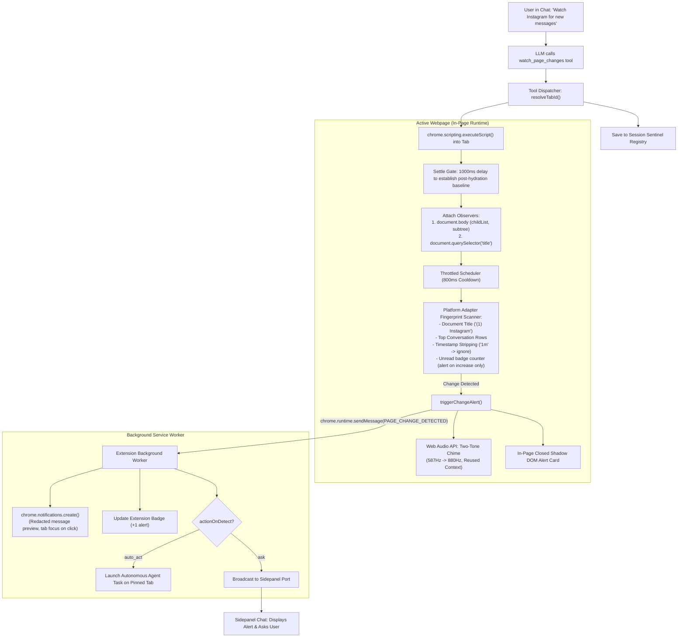

# NIM Agent — Watch & Sentinel Change Detection Architecture

> **Document Version:** 3.0  
> **Target Audience:** Core Developers, Security Reviewers, and External AI Auditors  
> **Primary Script File:** `src/lib/agent/sentinel/change-detector.ts`  
> **Secondary Script Files:** `src/lib/agent/sentinel/predicates.ts`, `src/lib/agent/sentinel/sentinel-registry.ts`, `src/lib/agent/tools/watch-tools.ts`, `src/lib/agent/watch-engine.ts`

---

## 1. Executive Summary

NIM Agent includes two distinct "Watch" subsystems:

1. **Sentinel In-Page Change Detector (`watch_page_changes`)** [Primary Focus]:
   - **Type:** Real-time, in-page DOM & event stream observer running inside the browser tab context.
   - **Latency:** Sub-second (<200ms detection, throttled to 800ms cooldown).
   - **Token Cost:** **0 LLM API tokens** consumed while idling / monitoring.
   - **Primary Use Cases:** Incoming chat messages (Instagram Direct, WhatsApp Web, Discord, Slack, Gmail), stock/crypto price shifts, restock drops, auction bid shifts, order status updates.
   - **Key Features:** Web Audio API two-tone alert chime, closed Shadow DOM HUD & notification cards, per-thread fingerprinting with dynamic timestamp stripping, OS-level Chrome notifications, unseen alert tracking in session storage, auto-recovery on tab reload, and dual reaction modes (`'ask'` vs `'auto_act'`).

2. **Scheduled Background Monitor (`create_watch`, `list_watches`, `delete_watch`)**:
   - **Type:** Periodic headless background checker powered by `chrome.alarms`.
   - **Latency:** Runs on periodic intervals (e.g., every 15, 30, 60 minutes).
   - **Token Cost:** Minimal per scheduled alarm check.
   - **Primary Use Cases:** Long-term periodic scraping (e.g., "Check flight prices every morning at 9 AM").

---

## 2. Complete File Directory & Component Map

| Component | Repository Path | Purpose |
|---|---|---|
| **Primary Sentinel Engine** | `src/lib/agent/sentinel/change-detector.ts` | In-page script injection, MutationObserver, Unread Fingerprint engine, audio chime, and HUD. |
| **Predicate Evaluator** | `src/lib/agent/sentinel/predicates.ts` | Pure condition parsing (numeric `<`, `>`, `contains:`, `regex:`, timestamp stripping, fast DJB2 hashing). |
| **Watcher Registry** | `src/lib/agent/sentinel/sentinel-registry.ts` | Session storage watcher tracking, badge updates, and unseen alert queue. |
| **Host Matcher** | `src/lib/agent/sentinel/host-matcher.ts` | Strict sub-domain and exact host matching helper. |
| **Unit Test Suite** | `src/lib/agent/sentinel/change-detector.test.ts` | Tests for snapshot diffing, unread dot detection, and chat row changes. |
| **Tool Dispatcher** | `src/lib/agent/core/tool-dispatcher.ts` | Dispatches `watch_page_changes` actions (`start`, `stop`, `status`). |
| **Zod Schemas** | `src/lib/agent/tools/schemas.ts` | Validates input parameters (`target`, `changeType`, `actionOnDetect`, `autonomousInstruction`, `allowSending`). |
| **Tool Definition** | `src/lib/agent/tools/index.ts` | Function calling definition registered with LLM (`AGENT_TOOLS`). |
| **Message Protocol** | `src/lib/messaging/protocol.ts` | Defines `PAGE_CHANGE_DETECTED` and `SENTINEL_TRIGGER_ACTION` extension messages. |
| **Background Worker** | `src/entrypoints/background.ts` | Listens for `PAGE_CHANGE_DETECTED`, triggers OS notifications, auto-restores watchers on reload, and launches autonomous tasks. |
| **Sidepanel Frontend** | `src/entrypoints/sidepanel/App.tsx` | Displays real-time alert cards in Sidepanel chat with action buttons. |

---

## 3. How the Sentinel Watch Tool Works (`watch_page_changes`)



---

## 4. In-Depth Technical Mechanics

### A. Zero Token Consumption While Idling
Unlike designs that poll by capturing screenshots or invoking LLM completions periodically (which quickly exhausts API token limits and costs significant money), **Sentinel runs 100% locally in JavaScript inside the user's browser tab**.
- No LLM requests are made while idling or waiting for events.
- The LLM is only invoked when `actionOnDetect === 'auto_act'` and a confirmed change event fires.

### B. Multi-Anchor SPA-Resilient Observation
In modern Single Page Applications (React 18+, Virtual DOM, StyleX):
- Components frequently unmount and remount.
- If an observer is attached to an inner element (e.g., `div[role="main"]`), React replaces that node during navigation, causing traditional observers to detach and die.
- **Sentinel's Resilience:**
  1. Attaches to `document.body` (an indestructible DOM root that React never unmounts).
  2. Attaches a dedicated observer to `<title>` in `<head>`.
  3. Re-resolves targeted elements by selector on every tick if the previous node was unmounted or replaced (`!targetEl.isConnected`).

### C. Platform Adapters & Timestamp Stripping
- **Instagram Direct:** Inspects `a[href*="/direct/t/"]` rows for unread badge markers or unread SVGs without invoking slow `window.getComputedStyle` in nested descendant loops (eliminating browser freezes).
- **WhatsApp Web:** Targets unread counter badges (`span[data-icon="unread-count"]`).
- **Gmail:** Targets unread rows (`tr.zE`) and tab badge numbers (`span.aKz`).
- **Timestamp Stripping (`cleanMessagingSnippet`):** Strips relative timestamps (`1m`, `2h`, `just now`, `• 5h`) and presence indicators (`Active now`, `Online`). A timestamp tick from `1m` to `2m` will not trigger a false-positive alert.
- **Unread Increases Only:** Alerts only fire when `currUnreadCount > prevUnreadCount`. When a user reads an email or opens a chat, the unread count decreases, which Sentinel safely ignores.
- **Self-Message Loop Prevention:** Messages beginning with `You:` / `You sent` / `You reacted` are tagged as own messages and do not trigger self-alerts.

### D. Audio Chime (Web Audio API)
- Purely synthetic two-tone chime (D5: 587.33Hz followed by A5: 880.00Hz).
- Single `AudioContext` is reused across alerts and safely closed on watcher stop.
- Includes automatic `AudioContext.resume()` for background tabs.

---

## 5. Security & False-Positive Defenses

### Closed Shadow DOM Isolation & Untrusted Event Guard
- The in-page HUD and alert cards are mounted within a closed Shadow DOM container (`attachShadow({ mode: 'closed' })`).
- Text content is set using `createElement` and `textContent`, strictly preventing in-page DOM-based XSS.
- All button handlers verify `event.isTrusted === true`, preventing page scripts from synthetically clicking extension UI elements.

### Untrusted Context Demarcation
- Page-derived text (e.g. change summaries, chat snippets) is never concatenated directly into LLM instruction strings.
- Summaries are wrapped with `wrapUntrustedContent(summary, 'sentinel:change_summary')` and provided as untrusted context.

### Tab Pinning & Autonomous Safety
- Autonomous tasks triggered by `PAGE_CHANGE_DETECTED` pin the execution to `sender.tab.id`, preventing actions against unintended foreground tabs.
- Outbound actions (`type_text`, `press_key: Enter`) during autonomous execution require Human-In-The-Loop approval unless explicit sending permission (`allowSending: true`) was pre-authorized by the user.

---

## 6. How to Verify / Test the Watch Feature

1. **Unit Tests:**
   ```bash
   npx vitest run src/lib/agent/sentinel/change-detector.test.ts
   npx vitest run src/lib/agent/sentinel/predicates.test.ts
   ```

2. **Self-Containment Verification:**
   ```bash
   npx vitest run src/lib/agent/sentinel/self-containment.test.ts
   ```

3. **Autonomous Safety Tests:**
   ```bash
   npx vitest run src/lib/agent/sentinel/phase2-safety.test.ts
   ```
