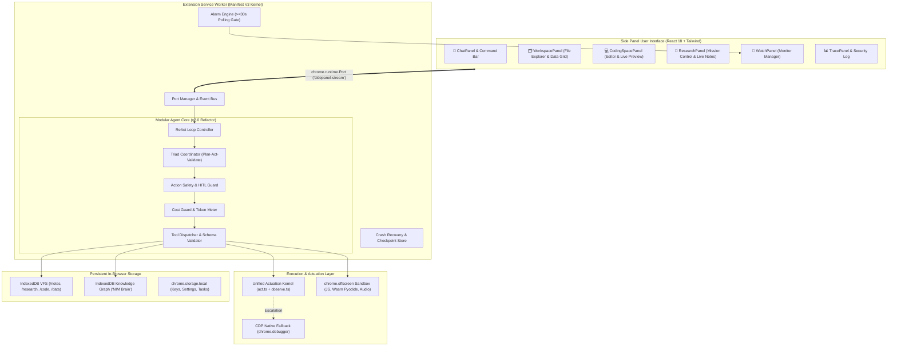

# NIM AGENT — TARGET ARCHITECTURE SPECIFICATION (v2.0)

**Project:** NIM Agent (Autonomous AI Browser Assistant)  
**Target Version:** `2.0.0`  
**Audit Date:** October 25, 2026  
**Auditor:** Principal Software Engineer, Senior Architect & Security Auditor  

---

## 1. Architectural Strategy: Evolution Without Disruption

The current architecture possesses robust core abstractions:
- An IndexedDB-backed Virtual File System (VFS).
- A Triad architecture (Planner-Actor-Validator) with self-healing fallbacks.
- Multi-provider LLM support (NIM, Gemini, OpenAI, Groq, Ollama).
- A reactive side-panel user interface.

However, it suffers from:
1. **Monolithic centralization in `engine.ts`** (2,083 lines mixing ReAct, DOM execution, CAPTCHA, and UI streaming).
2. **Orphaned content script** (`content.ts` is never loaded; duplicate DOM logic lives inline).
3. **Fragile sandboxing in `runner.ts`** (unencoded string interpolation into iframe markup).
4. **Platform assumption mismatches** (sub-minute `chrome.alarms` in MV3).

The target architecture incrementally refactors these weaknesses into a **modular, secure, event-driven agent operating system** running 100% natively in Chrome.

---

## 2. Target Architecture System Diagram



---

## 3. Subsystem Architectural Decisions

### 3.1 What Remains Unchanged
- **Virtual File System Core (`src/lib/workspace/vfs.ts`):** The IndexedDB object stores (`vfs_files`, `vfs_folders`), normalization, and in-memory fallback work reliably and have 100% test pass rates.
- **Provider Registry (`src/lib/llm/providers.ts`):** Presets for NVIDIA NIM, OpenAI, Groq, Gemini, and Ollama are well-structured.
- **AST Markdown Renderer (`src/entrypoints/sidepanel/components/MarkdownMessage.tsx`):** The custom parser avoids `dangerouslySetInnerHTML` and correctly renders tables, code blocks, and math.
- **Session Store & Blackboard (`session-store.ts`, `blackboard.ts`):** Clean, independent data persistence utilities.

### 3.2 What Is Refactored
- **`engine.ts` Decomposition:**
  The 2,083-line monolith is broken into four focused classes:
  1. `ReActLoopController`: Executes the step-by-step reasoning cycle, streaming events to the UI.
  2. `ToolDispatcher`: Maps validated Zod schemas to async tool functions.
  3. `TriadCoordinator`: Coordinates milestone checklist planning, before/after snapshots, and self-healing.
  4. `DOMActuator`: Standardizes interaction on `primitives/act.ts` and `primitives/observe.ts`.
- **`content.ts` vs Inline Scripts:**
  Remove duplicate element walkers from `engine.ts`. Standardize on `src/lib/agent/primitives/observe.ts` and `src/lib/agent/primitives/act.ts`.
- **Duration Parsing (`watch.ts`):**
  Fix the bare-number heuristic in `parseDuration`. Explicitly interpret numbers as minutes (or enforce unit strings: `20s`, `15m`, `1h`). Clamp minimum background alarms to 60 seconds to comply with Chrome MV3 production constraints.

### 3.3 What Is Replaced
- **Coding Space Execution Sandbox (`src/lib/code-runner/runner.ts`):**
  Replace string interpolation (`${code}`) with programmatic Blob execution or an offscreen worker. This permanently closes HTML tag breakout and script injection vulnerabilities.
- **Lossy Quarantine Sanitization (`src/lib/agent/quarantine.ts`):**
  Replace aggressive semantic summarization (`keyFacts.join('\n')`) with structural XML demarcations (`<untrusted_external_content>`). Use an LLM scanner only when high-risk injection phrases are detected in raw text.

### 3.4 What Is Added
- **`chrome.offscreen` Document Sandbox:**
  Add an offscreen document (`src/entrypoints/offscreen/`) configured with `CLIPBOARD`, `AUDIO_PLAYBACK`, and `IFRAME_SCRIPTING` for:
  - Clean JavaScript code execution.
  - Future Pyodide WebAssembly execution.
  - Text-to-speech audio executive briefings.
- **On-Device Gemini Nano Integration (`window.LanguageModel`):**
  Add a zero-cost local inference tier for passive entity extraction and prompt security checks.
- **CI/CD Pipeline (`.github/workflows/ci.yml`):**
  Automated GitHub Actions running typecheck, lint, vitest, and persistent Playwright tests.

---

## 4. Critical Execution Flow: Autonomous Web Task

```mermaid
sequenceDiagram
    autonumber
    actor User
    participant SidePanel as Side Panel UI
    participant Worker as Service Worker Kernel
    participant Loop as ReAct Loop Controller
    participant Actuator as Unified Actuator
    participant Page as Web Page DOM
    participant LLM as LLM Provider (NIM / Gemini)
    participant VFS as Virtual Workspace

    User->>SidePanel: "Compare price of RTX 4090 on Amazon vs BestBuy"
    SidePanel->>Worker: AGENT_START (taskId, instruction)
    Worker->>Loop: Initialize Session
    
    loop Every ReAct Step (Until Complete or Max Steps)
        Loop->>Actuator: observePage(tabId)
        Actuator->>Page: Scan affordances (Shadow DOM & piercing)
        Page-->>Actuator: Affordance list (buttons, inputs, prices)
        Actuator-->>Loop: Formatted affordance context
        Loop->>LLM: chatCompletion(prompt + affordances + tools)
        LLM-->>Loop: Tool call: act_on_element(action: "click", target: "5")
        Loop->>SidePanel: AGENT_STEP (reasoning, tool, running)
        Loop->>Actuator: actOnElement("click", target: "5")
        Actuator->>Page: Focus, scroll into view, dispatch pointer/click
        Page-->>Actuator: Mutation settled
        Actuator-->>Loop: Tool result: "Clicked element [5]"
        Loop->>SidePanel: AGENT_STEP (status: done, result)
    end

    Loop->>VFS: workspace_create_file("/research/rtx4090.md", report)
    Loop->>Worker: STREAM_DONE (finalReport)
    Worker->>SidePanel: STREAM_DONE (finalReport)
    SidePanel->>User: Render markdown table & notify completion
```

---

## 5. Security & Threat Model (STRIDE)

| Threat Category | Potential Attack Vector | Current Mitigation Status | Target Architecture Enforcement |
|---|---|---|---|
| **Spoofing** | Foreign extension sending messages to background worker | **Mitigated:** `sender.id !== chrome.runtime.id` check in `background.ts` | Retain strict `sender.id` check across all runtime listeners |
| **Tampering** | Web page injecting hidden instructions to modify agent state | **Partially Mitigated:** Quarantine LLM; heuristic regex | Rigid `<untrusted_external_content>` XML fences + Instruction Hierarchy |
| **Repudiation** | Actions taken without an audit trail | **Mitigated:** `src/lib/security/audit-log.ts` records events | Centralize all tool executions and HITL decisions to the audit log |
| **Information Disclosure** | Untrusted page reading API keys from storage | **Mitigated:** Keys stored in `chrome.storage.local` (isolated from web pages) | Keys never transmitted to web pages; offscreen sandbox has opaque origin |
| **Denial of Service** | Infinite tool execution loops burning token budget | **Mitigated:** `cost-guard.ts` token cap + action loop detector | Enforce strict per-task step caps and rate-limit backoffs |
| **Elevation of Privilege** | Sandboxed code escaping iframe to execute in side panel | **Vulnerable (FINDING-P0-02):** Template string interpolation | Isolate code execution in `chrome.offscreen` with JSON-serialized input |

---

## 6. Migration & Rollout Plan

The transition to Target Architecture 2.0 follows a zero-downtime, non-breaking 4-phase rollout:

1. **Phase 1: Stabilization & Bug Fixes (Week 1)**
   - Fix ESM `__dirname` in `playwright.config.ts`.
   - Fix `watch-tools.ts` assertion regression.
   - Patch `runner.ts` template literal script injection.
   - Fix `client.ts` `AbortError` retry bug.
2. **Phase 2: Platform Compliance & Alarm Hardening (Week 2)**
   - Fix `parseDuration` heuristic in `watch.ts`.
   - Clamp minimum background monitoring interval to 60s.
   - Configure ESLint and GitHub Actions CI.
3. **Phase 3: Modular Core Refactor (Week 3)**
   - Extract `ReActLoopController` and `ToolDispatcher` from `engine.ts`.
   - Deprecate orphaned `content.ts` and consolidate on `primitives/act.ts` and `observe.ts`.
4. **Phase 4: Advanced Capabilities (Week 4)**
   - Introduce `chrome.offscreen` document for code execution and speech synthesis.
   - Connect on-device Gemini Nano for zero-cost entity extraction.
